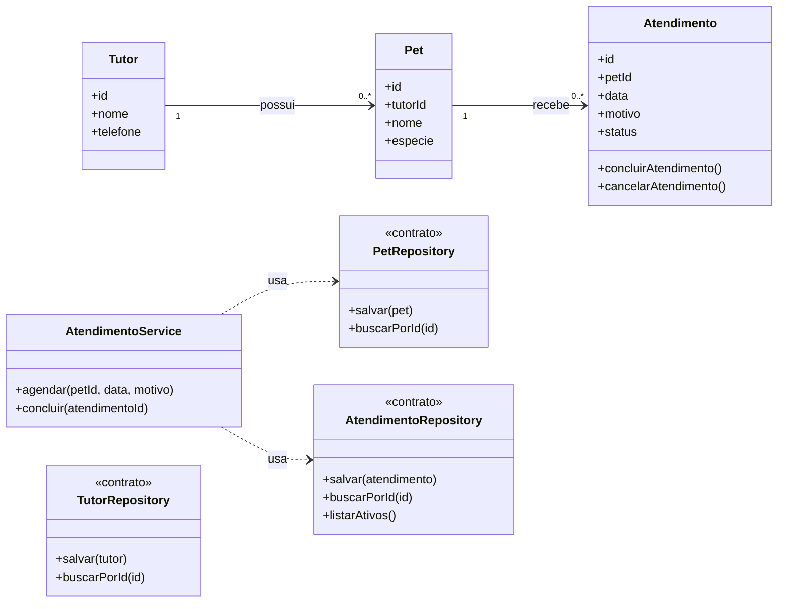

# Modelagem — Projeto 1

**Aluno(a):** Antonio Augusto Ramalho Nunes
**Domínio:** Gestão de atendimentos de uma Clínica Veterinária

## 1. O domínio

A clínica regista os tutores e os seus respetivos pets. O sistema controla os atendimentos veterinários, registando qual o pet atendido, o motivo da consulta e a data do atendimento.

## 2. Entidades

| Entidade | Atributos | Relacionamentos |
|---|---|---|
| Tutor | id, nome, telefone | possui vários pets |
| Pet | id, tutorId, nome, especie | pertence a um tutor e possui vários atendimentos |
| Atendimento | id, petId, data, motivo, status | pertence a um pet |

## 3. Diagrama de classes

## 4. Responsabilidades

| Classe | Papel | Único motivo para mudar |
|---|---|---|
| Tutor, Pet, Atendimento | entidades | as regras do próprio objeto (ex.: alterar o status de um atendimento) |
| AtendimentoService | regra de negócio | o fluxo e as validações para agendar ou concluir uma consulta |
| TutorRepository, PetRepository, AtendimentoRepository | acesso aos dados | a forma de persistir os dados (SQLite, arrays em memória) |

## 5. Onde apliquei SRP e DIP

- **SRP:** As entidades `Tutor`, `Pet` e `Atendimento` mantêm apenas o seu estado. Não gravam dados na base de dados. Essa responsabilidade foi delegada aos repositórios correspondentes.
- **DIP:** O `AtendimentoService` depende apenas dos contratos (`<<contrato>>`) dos repositórios injetados, não conhecendo os detalhes de implementação da base de dados.

## 6. Fora do escopo (YAGNI)

Faturação, gestão de stock de medicamentos, internamentos complexos e relatórios financeiros não entram no Projeto 1.